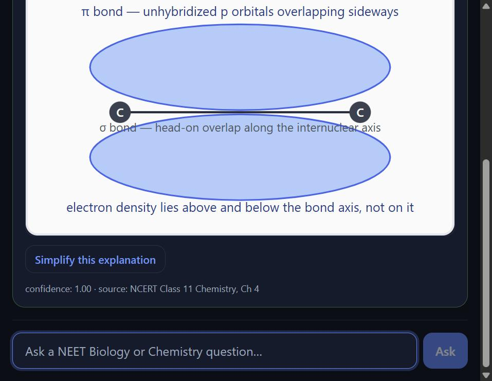
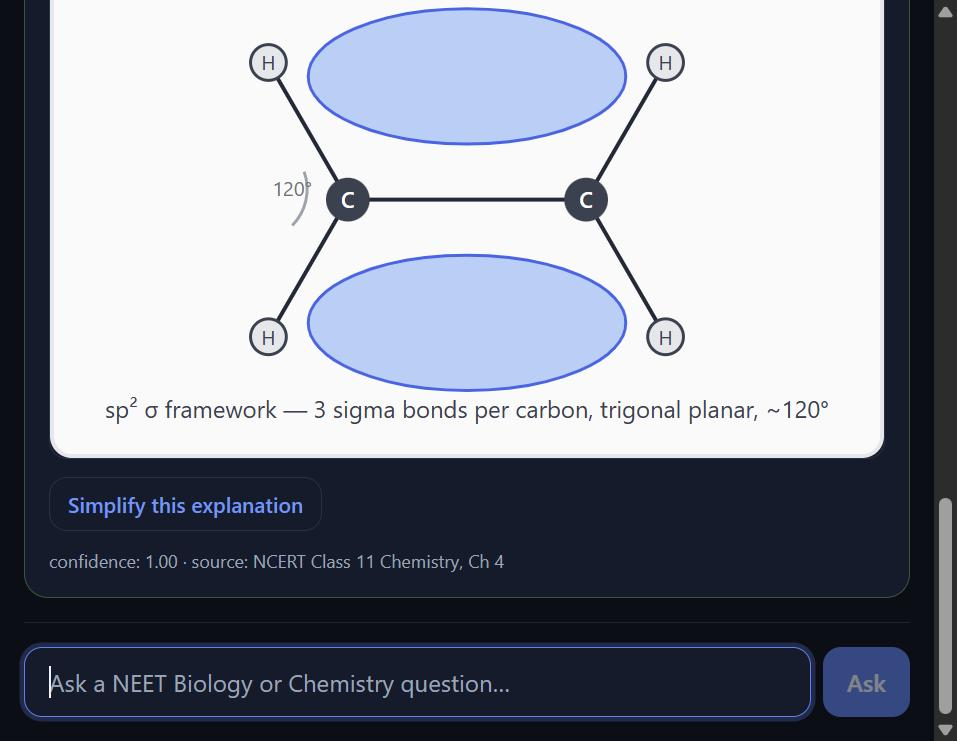
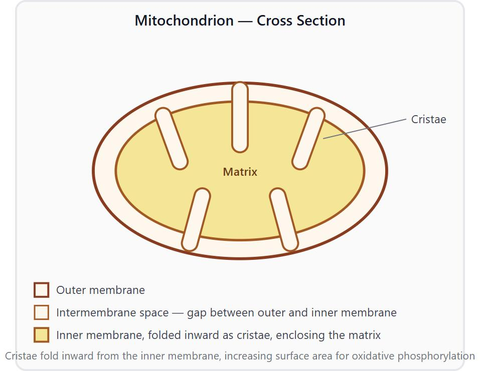

# NEET Prep Engine

**Live:** https://neet-prep-engine.web.app

The cloud backend runs on a free tier that sleeps when idle, so the first
question that needs it after a quiet period can be slow or time out. Answers
from the built-in item bank are unaffected.

An offline-first exam-prep PWA for NEET Biology and Chemistry, built around
one rule: never guess. A question is answered from a local item bank of
NCERT-sourced answers, which works with no internet after the first load. If
nothing in the bank matches well enough, the app either gets an answer that
two independent AI models agree on (clearly labeled as AI-generated), or it
refuses and flags the question for review.

Built solo, using Claude Code alongside manual review and testing. The commit
history shows the debugging trail, not just the finished result.

## Features

- **Offline Q&A from the item bank.** 39 items (9 Biology, 30 Chemistry,
  mostly Chemical Bonding). Matching is deterministic and typo-tolerant, with
  no model and no network involved. Answers are labeled `VERIFIED` and show
  their NCERT source.
- **Refusal and flagging instead of guessing.** A match below the confidence
  threshold (0.55) is never shown as an answer. The question is logged for
  review and the app says it has no verified answer.
- **Installable PWA.** A service worker caches the app shell and the item
  bank, so it can be installed and used offline.
- **On-device "Simplify this explanation".** Optional, shown under verified
  answers only. Runs a small text model (LaMini-Flan-T5, roughly 250 MB,
  downloaded on first use) in the browser with `transformers.js`. Nothing is
  sent to a server, and the original answer stays on screen above the
  simplified one.
- **Cross-checked cloud escalation.** For questions outside the item bank, two
  Gemini models answer independently and a judge step checks that they agree.
  Only then is the answer shown, labeled `AI-GENERATED — PENDING
  VERIFICATION`. Escalated answers are cached on the device so a repeat
  question works offline.
- **Diagrams on 3 items**, rendered inline next to the verified answer.

## How it works

| Tier | Where it runs | What it does |
| --- | --- | --- |
| 0 | Browser, offline | Scores the typed question against every item (character-sequence similarity plus fuzzy keyword overlap). At or above 0.55 it answers from the bank; below that it refuses and flags. |
| 1 | Browser, on-device model | Rephrases an already-verified answer in simpler words. The prompt forbids adding facts, and the output is labeled as on-device AI. |
| 2 | `api/` on Render | Calls `gemini-flash-latest` and `gemini-flash-lite-latest` in parallel, then asks the second model to judge whether the two answers agree. Agreement serves the first answer. Disagreement serves nothing and logs both answers for review. If the judge call itself fails, that counts as disagreement. A transient 503 from Gemini is retried twice (1 s, then 2 s); a 429 quota error is not retried. |

Tier 2 behavior is covered by unit tests with the Gemini client mocked. The
disagreement path and a successful escalation from the browser UI have not
yet been confirmed against the live service.

`docs/architecture.md` has the full design, including the planned human
review step (Tier 3) and the decision log. The two Tier 2 models are from the
same family because the free-tier key has no quota for a Pro-class model;
that trade-off is recorded there.

## Screenshots

Diagrams as rendered in the running web app:

| Item | Diagram |
| --- | --- |
| `chem-0025` — pi (π) bond |  |
| `chem-0015` — ethene sp² hybridization |  |
| `bio-0001` — mitochondrion |  |

## Tests

| Suite | Tests | Covers | Command |
| --- | --- | --- | --- |
| CLI (`unittest`) | 10 | Item bank loading, clear match, typo near-miss, unrelated question refused and logged, pasted MCQ options, diagram note | `python -m unittest discover -s apps/prototype-cli/tests -p "test_*.py" -v` (from the repo root) |
| Web (`vitest`) | 3 | MCQ-option stripping in the TypeScript matcher, the Simplify prompt | `npm test` (in `web/`) |
| API (`pytest`) | 13 | 503 retry, no retry on 429, refusal handling, judge failing closed, agree and disagree outcomes, error priority | `pytest` (in `api/`, after `pip install -r requirements-dev.txt`) |

The API tests mock the Gemini client, so they need no API key and make no
network calls. `npm run typecheck` in `web/` runs the TypeScript compiler
without emitting.

## Run locally

Requirements differ per component:

- **CLI** (`apps/prototype-cli/`): Python 3.9+, standard library only.
- **Web** (`web/`): Node.js 18+ and npm. Python is also needed once, to build
  the item bank JSON.
- **API** (`api/`): Python 3.10+ (the Docker image uses 3.12), the packages
  in `api/requirements.txt`, and a Gemini API key.

### CLI

```
cd apps/prototype-cli
python main.py
```

Type a NEET Biology or Chemistry question at the `>` prompt; `quit` or `exit`
stops it. A confident match prints `[VERIFIED]` with the answer, confidence
and source. Anything else prints `[REFUSED]` and appends the question to
`apps/prototype-cli/flagged_questions.jsonl` (git-ignored). The CLI is Tier 0
only: no model, no network, no diagrams.

### Web

```
python scripts/build_item_bank_json.py
cd web
npm install
npm run dev
```

The first command builds `web/public/item_bank.json` and copies the diagram
SVGs from `item_bank/`. Both are git-ignored build artifacts, so re-run it
whenever a `.jsonl` file changes. The dev server opens on
http://localhost:5173.

To try escalation locally, run the API (below) and copy `web/.env.example` to
`web/.env.local`, which points `VITE_API_BASE_URL` at
`http://localhost:8000`. If the backend cannot be reached, low-confidence
questions fall back to the "NO VERIFIED ANSWER — flagged" message.

### API

Get a Gemini API key from
[aistudio.google.com/apikey](https://aistudio.google.com/apikey). Then, on
Windows:

```
cd api
python -m venv .venv
.venv\Scripts\activate
pip install -r requirements.txt
copy .env.example .env
```

Set `GEMINI_API_KEY` in `api/.env`. That file is git-ignored and must never
be committed. Then:

```
uvicorn main:app --reload --port 8000
```

Check it with `curl http://localhost:8000/healthz`, which returns
`{"status":"ok"}`.

## Deploy

### API on Render

`render.yaml` at the repo root is a Render Blueprint defining one Docker web
service (`neet-prep-api`, free plan, Singapore region, built from
`api/Dockerfile`).

1. In the Render dashboard choose **New → Blueprint** and connect this repo.
2. Enter `GEMINI_API_KEY` when prompted. It is marked `sync: false`, so the
   key lives only in the Render dashboard and is never written to the YAML
   or to git.
3. Apply. Render builds the image and assigns the service URL.

`render.yaml` also sets `ALLOWED_ORIGINS` to the live web app and pins the
two model names.

### Web on Firebase Hosting

`web/.firebaserc` already points at the `neet-prep-engine` Firebase project.
The API base URL is read at build time, so set `VITE_API_BASE_URL` in
`web/.env.local` to the Render service URL before building.

```
python scripts/build_item_bank_json.py
cd web
npm run build
firebase deploy --only hosting
```

This needs `firebase-tools` installed and `firebase login` done once.
`web/firebase.json` handles the SPA rewrite and sets `no-cache` on `sw.js`
and `item_bank.json` so updates are picked up.

## Repository layout

- `item_bank/`: `biology/` and `chemistry/` hold the items as JSONL (9 and
  30). Also `schema.json` for one item, `diagrams/` (3 SVGs) and
  `misconceptions/taxonomy.json` (an empty skeleton for now).
- `apps/prototype-cli/`: `retrieval.py` (matching), `refusal.py`
  (answer-or-refuse decision and flag log), `main.py` (terminal loop),
  `tests/`. This is the reference logic; `web/src/retrieval.ts` and
  `refusal.ts` are a TypeScript port of these two files with the same
  behavior.
- `web/`: React + TypeScript (Vite) PWA. Includes the service worker, the
  on-device Simplify feature (`src/tier1.ts`, `src/Simplify.tsx`), the
  escalation client (`src/api.ts`) and the device-local answer cache
  (`src/answerCache.ts`).
- `api/`: FastAPI backend with `POST /escalate` and `GET /healthz`.
  `gemini_client.py` runs the two-model cross-check and judge step; `db.py`
  logs escalations to a SQLite `flagged_items` table for later human review.
- `scripts/`: `build_item_bank_json.py` (builds the web item bank) and
  `generate_placeholder_icons.py` (one-off generator for the placeholder PWA
  icons).
- `docs/`: `PRD.md`, `architecture.md`, and `screenshots/`.
- `render.yaml`: Render Blueprint for `api/`.

## Known limitations

- **Offline flags stay on the device.** Questions refused in the web app are
  logged to `localStorage` and are not synced to the server.
- **Render free tier.** The service sleeps when idle and takes roughly 50
  seconds to cold start. The web client gives up on an escalation after 30
  seconds, so the first one after idle can come back as "flagged"; try again
  once the service has woken up. The free tier also has no persistent disk,
  so the SQLite `flagged_items` database resets on every restart or deploy.
- **Gemini free tier.** Quota is limited, and Gemini sometimes returns 503
  "high demand" errors that outlast the two retries. Either way the app shows
  the flagged message instead of an answer.
- **On-device model cache.** When the service worker updates, its cleanup
  step deletes every cache except the app's own, which includes the
  downloaded `transformers.js` model. Simplify then has to download the model
  again.
- **Small item bank.** 39 items, and 4 of the 9 Biology items are still
  marked `verified_by: pending` in the data even though the app labels every
  item bank match `VERIFIED`.

## Roadmap

- A bigger item bank across more chapters
- "Explain further" on answers
- Voice input and output using WASM Whisper and the Web Speech API (not
  shipped; the app is text-only today)
- Spaced repetition
- Testing on low-RAM phones
